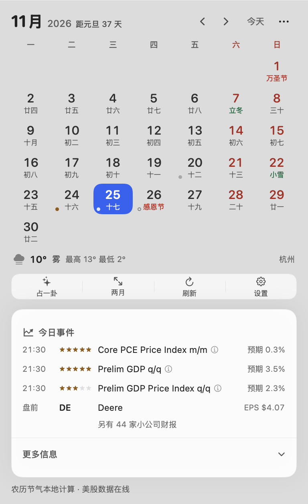
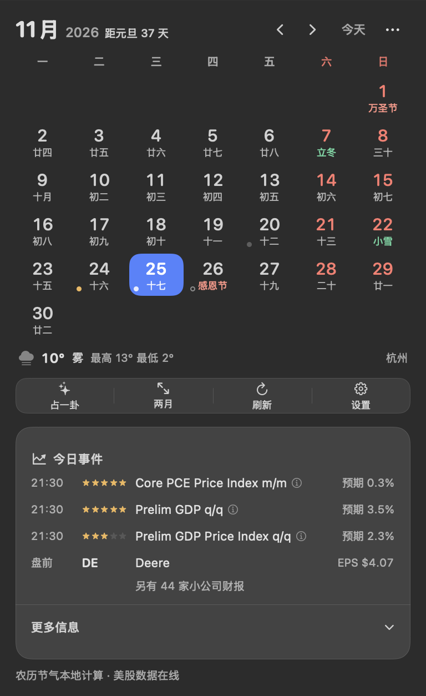
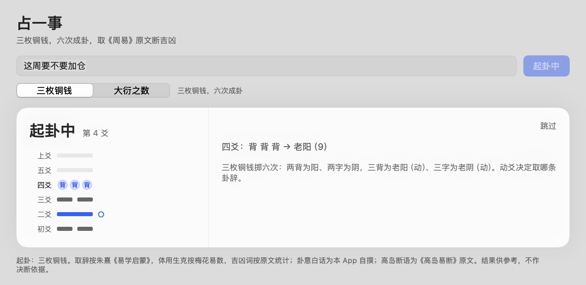
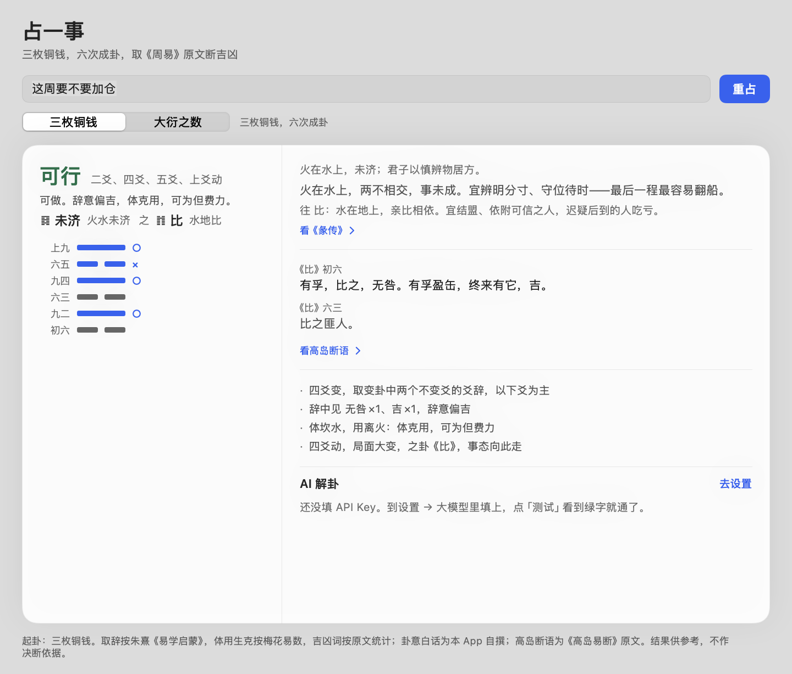
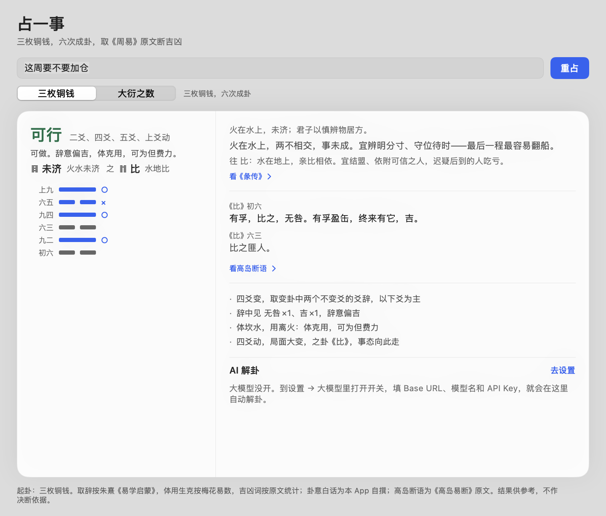
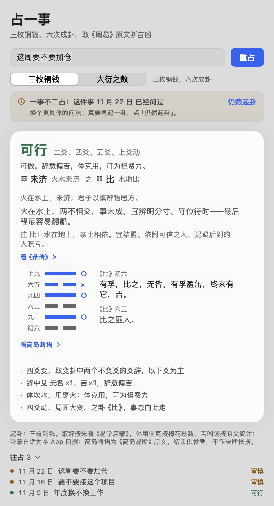
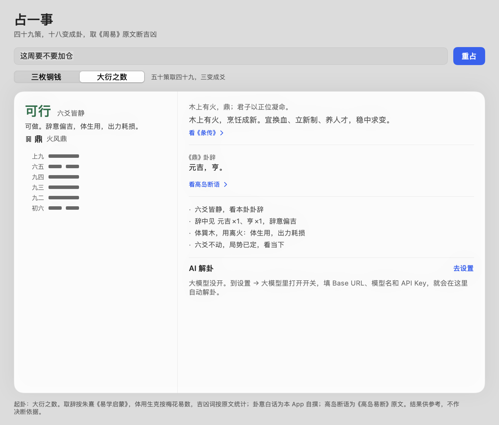
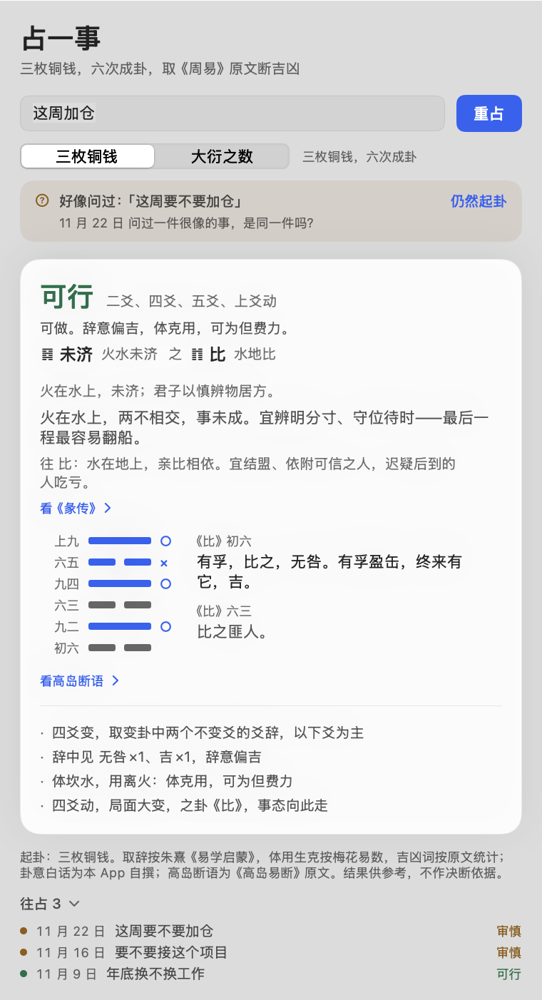
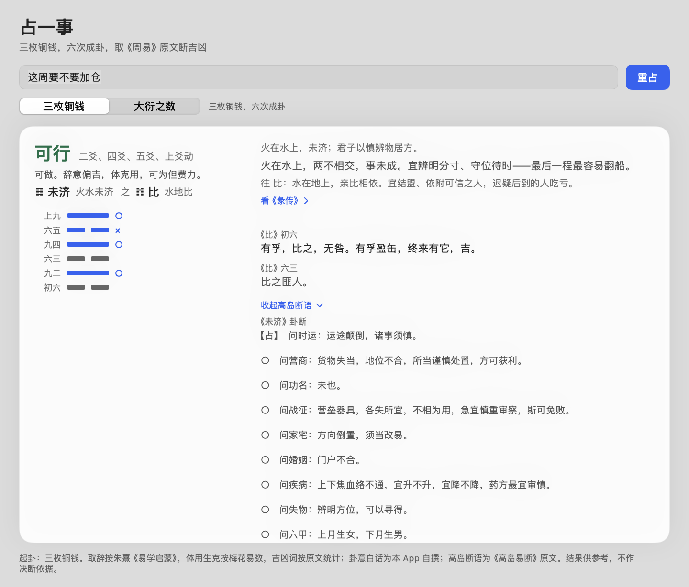
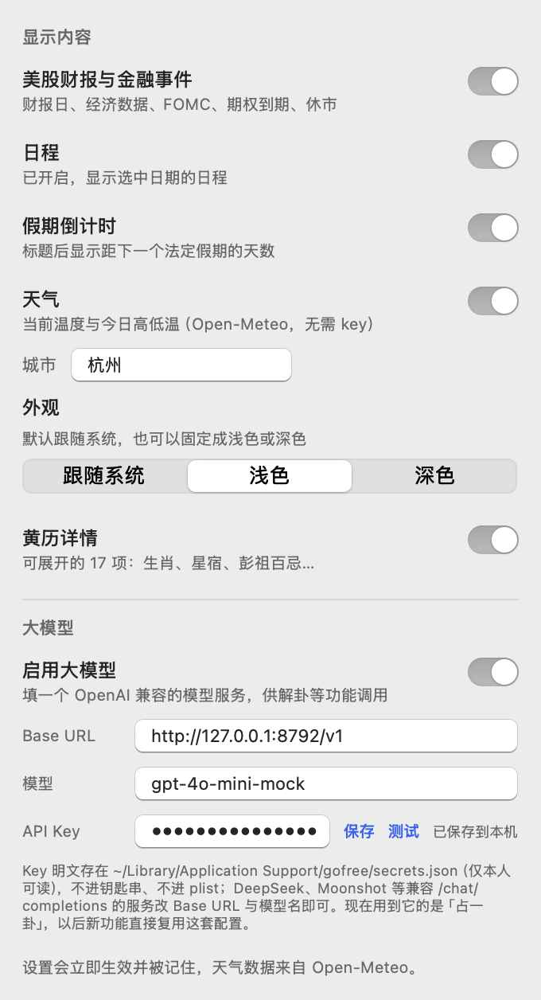

# gofree

macOS 菜单栏万年历 + 美股日历：点开菜单栏就是一整月，农历、节气、节日、休班、美股财报与重要经济数据一眼看完。

原生 SwiftUI（`MenuBarExtra`），无 Electron，唯一依赖是源码内置的 MIT 算法库，App 体积约 2.3MB。要求 **macOS 15（Sequoia）及以上**——用到了 `@Observable`、新版 `onChange` 与 `onGeometryChange`。



深色模式会自动跟随系统：

## 功能

- **菜单栏标题**：显示今天日期和星期（如 `11/24 周二`），每分钟自动刷新
- **配置中心**：菜单 →「设置…」可分别开关美股、日程、假期倒计时、天气、黄历详情，以及配置大模型，天气还能填城市；**外观可选跟随系统 / 浅色 / 深色（默认跟随系统）**，改动立即生效并记住
- **天气**：网格下方一行显示**选中那天**的天气（Open-Meteo，无需 key，默认北京，配置中心可改城市）
  - 缓存：按「城市 + 日期」存在 `~/Library/Application Support/gofree/weather.json`。今天与未来 15 天 30 分钟内不重复请求，历史日期（archive 接口取回后）永久缓存，只保留最近 60 天
  - 断网兜底：刷新失败时不清空，继续显示缓存并在后面标「未更新」；完全没缓存才显示错误（`gofree --weather 杭州 2026-11-27` 可看到「来源：预报（缓存未更新）　抓取于 …」）
  - 今天：当前温度 + 体感 + 天况 + 今日高低
  - 未来 1–15 天：预报高低与天况，标注「预报」
  - 过去日期：`archive-api` 的历史实况，标注「实况」
  - 超出 15 天：直接提示「超出 15 天预报范围」，不发请求
  - 改城市立即重拉（即使菜单栏窗口当时没打开），并先清掉上一个城市的数据，不会短暂显示旧城市
  - 按「城市 + 日期」缓存到 `~/Library/Application Support/gofree/weather.json`：历史永久有效、今天与未来 30 分钟内不重复请求，只保留最近 60 天；城市经纬度也缓存一次
- **假期倒计时**：月份标题后显示「距元旦 38 天」，按选中日期算，翻月或点别的日期立刻更新
- **功能条**：网格下方一排按钮——占一卦、两月视图、刷新、设置
- **放大视图**：点功能条的「两月」，浮窗自动收起并开一个独立窗口并排显示连续两个月（可 ‹ › 翻月、点任意一天同步回菜单栏浮窗）
- **月历网格**：周一起始 7×6 网格，每格显示公历日 + 农历/节气/节日；节气绿色、节日红色、周末红字，今天蓝底
- **休 / 班角标**：来自国务院办公厅放假通知，调休上班的日子不会漏
- **每日详情**：节日胶囊、美股事件表格、可展开的 17 项黄历详情（日期与农历看网格里选中的格子，卡片不再重复）
- **更多信息**：生肖、星座、彭祖百忌、胎神占方、五行、星宿、冲煞、六曜、十二神等 17 项
- **占一事**：点功能条「占一卦」（或菜单）开一个 720 宽的横向大窗，写下要做的事，起卦后取《周易》原文断「可行 / 审慎 / 不宜」——左栏是结论、卦名与六爻图、往占记录，右栏装长文（卦意白话、所取卦辞爻辞、高岛断语、理由、AI 解卦），右栏内部滚动，展开区段窗口尺寸不变
  - **两种起卦方式**：三枚铜钱（四者等概）或大衍之数（蓍草，五十策取四十九，分二、挂一、揲四、归奇，十八变成卦）；选过一次就一直记住
  - **卦意**：大象原文（如「火在水上，未济；君子以慎辨物居方」）+ 一句白话，之卦也附一句
  - **一事不二占**：同一个问题再问会被拦下，提示上次问的日期，可显式点「仍然起卦」越过；措辞相近（问法被包含，或二元组相近度 ≥ 0.8）也会提醒一句，但不硬拦——「加仓」与「减仓」只差一字却意思相反，所以判定用二元组而不是单字重合
  - **往占**：自动记录每次占问（问题、时间、爻值），折叠列表里可回看当时的卦与断语
  - **起卦过程**：不是瞬间出结果——自下而上逐爻落成，当前一爻显示演算状态：铜钱法摇出三枚正反面，蓍草法显示三变后剩余策数（四十九 → 四十四 → 四十 → 三十六），六爻成卦才给断语；嫌慢可点「跳过」
  - **AI 解卦**：配好大模型（配置中心「大模型」：Base URL / 模型名 / Key 存在本机文件）后，起卦完自动把这一卦译成一段白话；也可以点「重新解读」，支持取消。模型只做"翻译"，吉凶仍由本地的取辞与体用规则算
  - **高岛断语**：点「看高岛断语」展开高岛嘉右卫门《高岛易断》原文——本卦卦断 + 各动爻的爻断 + 之卦卦断
- **可选日程**：菜单里开启后显示当天 EventKit 日程（需授权日历访问，默认关闭）
- **翻月瞬间到位**：全部数据本地算，点一下就换月，没有加载态、不联网
- **完全离线**：装好就能用，断网、机场、内网都正常；不抓任何万年历站点
- **深色模式**：跟随系统外观，配色与卡片层次单独适配
- **美股日历**：财报日、重要经济数据（CPI / 非农 / FOMC 等，带**五星制重要级别**）、FOMC 决议日、期权到期日、休市日与提前收盘；网格左下角小圆点标记，详情卡一张四列表格排开
- **历法全离线、美股数据在线**：日历本体不联网，只有美股事件需要网络，且带磁盘缓存

## 数据来源

**没有任何万年历 API。** 农历、干支、节气、节日、黄历详情全部由本地算法算出，节假日由内置数据兜底。

### 历法与黄历：[lunar-swift](https://github.com/6tail/lunar-swift)

`Vendor/LunarSwift/`（MIT，v1.1.9，31 个 Swift 文件）以源码形式内置，使用说明表体系（寿星天文历），和市面上万年历站点同源：

- 农历日期、闰月处理、年/月/日干支、生肖
- 24 节气与「第 N 天 / 距下一个节气几天」推算
- 星宿、六曜、十二神、彭祖百忌、胎神占方、五行、冲煞
- 传统节日（春节/除夕/中秋/元宵…）与公历节日

年份切换按**立春**（`yearInGanZhiExact`），与黄历习惯一致；生肖同步按立春切换。

### 法定节假日 / 调休补班

- 内置 2025–2027 三年放假安排（`Resources/Holidays.json`），内容出自每年 11 月国务院办公厅的放假通知，装好即用
- 超出内置年份时按需拉取 `https://cdn.jsdelivr.net/gh/NateScarlet/holiday-cn@master/YYYY.json`（内容同样来自公告原文，文件里带公告链接）
- 缓存位置 `~/Library/Application Support/gofree/holidays/YYYY.json`，每 6 小时最多刷新一次
- 拉取失败不影响日历，只是超出内置年份的休班标记会缺失

### 美股事件

| 内容 | 来源 | 是否需要 key |
| --- | --- | --- |
| 财报日（公司名 / 盘前盘后 / EPS 预期） | Alpha Vantage 财报日历，`horizon=3month` 一次覆盖未来三个月 | 不需要（demo key） |
| 重要经济数据（北京时间，带重要级别） | forex factory 周历镜像 `ff_calendar_thisweek.json`，只取 High / Medium 两档，折算 5 星 / 3 星 | 不需要 |
| FOMC 议息决议日 | 美联储官网 2026–2027 会议日程，硬编码在 `fomcDecisionKeys` | 纯本地 |
| 期权到期日（每月第三个周五 / 季度四巫日） | 规则计算 | 纯本地 |
| 美股休市日 / 提前收盘（13:00 ET） | 纽交所官方规则 + 节假日顺延，已与官方 2026–2028 日历逐条核对 | 纯本地 |

- **只标大公司**：财报日历每天有 20–50 家，小票全标等于噪音。用内置的标普 500 成分股名单（`Resources/sp500.txt`，503 家）筛，只有成分股才在网格上打点、才进详情卡。
- **鼠标悬停**任意经济指标（或它后面的 ⓘ）会在行上方浮出解释卡，点一下可以锁住不消失，内容是「这是什么 + 对美股的影响」，词条在 `Sources/IndicatorGlossary.swift` 里维护，覆盖 CPI / PCE / 非农 / GDP / PMI / 初请 / FOMC 等 40 多个常见指标；财报行悬停显示盘前/盘后的含义。
- 星级来自数据源的 impact 三档（High 5 星、Medium 3 星、Low 1 星不展示），不是官方评级，只是「值不值得盯」的排序参考。
- 详情卡的表格固定四列：`时间/盘前盘后 → 星级或代码 → 名称 → 预期值/EPS`，两组数据共用列宽，行高一致。
- 网格圆点含义：**金** 有大公司财报 / **红** FOMC 决议 / **灰** 期权到期（深浅区分月度与四巫日）/ **空心圈** 美股全天休市。
- 休市覆盖元旦、马丁·路德·金纪念日、总统日、耶稣受难日、阵亡将士纪念日、六月节、独立日、劳动节、感恩节、圣诞节，含「周六提前到周五、周日顺延到周一」；提前收盘是感恩节次日、平安夜，以及独立日前夕（7/4 落在周二至周五时），并换算出北京时间的实际收盘时刻。
- Alpha Vantage 的财报日历按「今天起三个月」给出，越靠后的月份预估日期越不全；到期后自动重新拉取。
- 经济数据源只有本周（上游就是这么给的，没有免费的全月源），翻到别的周不会有数据。
- 缓存：`~/Library/Application Support/gofree/market/`，6 小时内不重复请求；两个请求之间至少间隔 1 秒。

### 占卦：《周易》原文

- 起卦两种古法：铜钱法每爻以三枚铜钱的正反定 6/7/8/9；蓍草法按大衍之数逐步模拟（分二→挂一→揲四→归奇，三变成一爻），两者概率不同——铜钱四者近似等概，蓍草为老阳 3/16、少阴 7/16、少阳 5/16、老阴 1/16（自检里用 4000 次抽样核对了这组比例）
- 六十四卦的卦辞、三百八十四爻辞、《彖传》与《象传》大象都来自[中文维基文库《周易》](https://zh.wikisource.org/wiki/周易)（公有领域）；**卦意那句白话是本 App 自撰的**，不是古籍原文，界面上也标了；异文注（「一作某」）已剔除，正文字句未改
- **高岛断语**取自高岛嘉右卫门（1832–1914）《高岛易断》的文言汉译，作者 1914 年去世，著作已进入公有领域；电子文本整理自 [killinitzero/takashima-divination](https://github.com/killinitzero/takashima-divination) 的 `iching_data.py`，按「上卦/下卦」对齐到本 App 的六十四卦（已逐卦核对卦名，64/64 全部对应），合进 `Resources/iching.json`（简体，541KB）。该仓库本身没有声明开源许可证，自己用没问题；**若要对外分发，请自行确认文本来源与授权**
- 高岛原文多为成段断例（含「【占】问时运」「○ 问营商」「问功名」等分类），长度几十到几百字，所以界面上收在 210pt 的滚动区里，点开才看
- 起卦用古法三枚铜钱：三字为老阴、一背为少阳、二背为少阴、三背为老阳，自下而上六次成卦；老阴老阳为变爻
- 取辞按朱熹《易学启蒙》的变爻规则：六爻皆静看本卦卦辞；一爻变看该爻爻辞；二爻变两爻并看以上爻为主；三爻变本卦与之卦卦辞并看；四爻变看之卦两个不变爻、以下爻为主；五爻变看之卦不变爻；六爻变乾用九、坤用六，其余看之卦卦辞
- 吉凶判断是把取到的原文做量化，不是通灵：统计原文里的吉凶断词（吉/元吉/无咎/悔亡 为吉，凶/厉/吝/悔/不利 为凶），再按梅花易数的体用生克（动爻所在卦为用，另一卦为体，看五行生克）加权，最后落在三档结论上
- 没有随机之外的「输入」：同一件事不要反复问，起卦结果本身是随机的，判断只是把卦爻辞读给你听
- 高岛断语是**明治时代的文言汉译**（不是现代白话），术语如「问六甲」「问战征」需要一点耐心；断语只随卦与动爻走，不与你的具体问题做语义匹配——它讲的是这一类事，不是这一件事
- 往占记录写在 `~/Library/Application Support/gofree/divination.json`，只存问题、时间与六爻爻值（卦象和断语据此重算）；判定「同一件事」只看问法的文字（忽略空白与标点），换个说法就会被当成新问题


五个状态同一个 720 宽横向布局（空态 720×215、起卦中 720×350、结果态 720×614，展开高岛/AI 只在卡内滚动、窗口不变高）。

起卦过程（第 4 爻正在摇钱，上面已成的爻带 ○／× 标动爻）：

接了大模型之后的解卦：

没配大模型时不会"消失"，而是留在原位给一行说明和「去设置」：

失败时长这样（不会静默失败）：

带往占记录的样子（含「一事不二占」提示）：

大衍之数（蓍草）起卦：

问法相近时的提醒：

展开高岛断语（原文较长，收在滚动区里）：

### 大模型配置（可选，全局）

配置中心里的「大模型」是一份**通用**配置，不是为解卦单独做的：占一卦是第一个使用者，以后新功能直接复用同一份 Base URL / 模型 / Key。

对占一卦来说，卦象、卦辞、动爻、高岛断语都是本地现成的，大模型只负责把它们讲成人话，不参与吉凶判断：

- 接口：OpenAI 兼容的 `POST {Base URL}/chat/completions`，默认 `https://api.openai.com/v1` + `gpt-4o-mini`；DeepSeek、Moonshot 等改 Base URL 与模型名即可
- 提示词：六爻、本卦与卦辞、大象、之卦、取辞规则与所取原文、高岛卦断（按问题里的词挑相关的分条，不整段塞）、程序的吉凶倾向与理由；系统提示要求先给结论、结合具体问题、不许自编卦辞、不做投资医疗法律建议
- 密钥：API Key 存 `~/Library/Application Support/gofree/secrets.json`，权限 0600（仅本人可读）；**不用钥匙串**、不写进 plist。注意是明文：只防同机其他用户，不防本人账户下的其他程序。关掉开关就不发请求
- 隐私：只发这一卦的文本，不带日历、天气、日程等任何本地数据
- 命令：`gofree --llm "这周要不要加仓" --seed 7` 可直接在终端验一遍配置（未配置会明确提示）



## 构建

需要 macOS 15+、Xcode 16+（命令行工具即可）和 [XcodeGen](https://github.com/yonaskolb/XcodeGen)：

```bash
brew install xcodegen
./tools/build.sh          # 生成工程 + Release 编译 + ad-hoc 签名
open "build/Build/Products/Release/gofree.app"
```

只想在 Xcode 里调试：

```bash
xcodegen generate
open gofree.xcodeproj
```

## 打包 dmg

```bash
./tools/package_dmg.sh    # 产出 dist/gofree.dmg
```

dmg 里包含 App、`Applications` 软链和一份打开说明。

## 安装与首次打开

本项目用 **ad-hoc 签名、未做 Apple 公证**（没有付费开发者账号），所以首次打开会被 Gatekeeper 拦住。任选一种方式：

1. 系统设置 → 隐私与安全性 → 向下滚动找到「gofree」→ 点「仍要打开」→ 确认
2. 终端执行：

```bash
xattr -dr com.apple.quarantine "/Applications/gofree.app"
```

> macOS 15 Sequoia 起「右键 → 打开」的旧绕过方式已失效，只能用上面两种。

## 自测

`--selftest` 用已知答案断言算法输出，覆盖农历、闰月、干支、节气、春节放假与补班、闰年 2 月等边界：

```bash
./build/Build/Products/Debug/gofree.app/Contents/MacOS/gofree --selftest
# 自检完成：168 项检查，0 项失败
```

打印某天的美股事件（验证抓取链路）：

```bash
A=./build/Build/Products/Debug/gofree.app/Contents/MacOS/gofree
"$A" --market 2026-12-09
# 2026-12-09 FOMC=true 期权到期=false 四巫日=false
# 财报 20 家（大公司 2 家）
#   ★ ADBE Adobe 盘后 EPS $5.11
#   ★ AVGO Broadcom 盘后 EPS $3.45
```

起一卦看看（`--seed` 固定卦象，便于复现）：

```bash
"$A" --divine "这周要不要加仓"
"$A" --divine "要不要接这个项目" --seed 42
```

自检里美股休市部分按官方日历逐年核对（2026、2027 各十天，2028 九天，2028 年元旦落在周六不放假），提前收盘单独校验。

渲染弹窗截图（开发自查用，不需要点开菜单栏）：

```bash
A=./build/Build/Products/Debug/gofree.app/Contents/MacOS/gofree
"$A" --preview /tmp/preview.png 2026-09 23
"$A" --preview /tmp/more.png 2026-11 24 --more
TC_PREVIEW_DARK=1 "$A" --preview /tmp/dark.png 2027-02 06
TC_PREVIEW_EXPANDED=1 "$A" --preview /tmp/expanded.png 2026-11 24     # 连续两个月放大视图
TC_PREVIEW_DIVINE="这周要不要加仓" TC_PREVIEW_SEED=7 "$A" --preview /tmp/divine.png 2026-11 24
TC_PREVIEW_DIVINE="-" "$A" --preview /tmp/divine-empty.png 2026-11 24   # 占一事的初始态
TC_PREVIEW_DIVINE="这周要不要加仓" TC_PREVIEW_DIVINE_TUAN=1 "$A" --preview /tmp/divine-tuan.png 2026-11 24
TC_PREVIEW_DIVINE="这周要不要加仓" TC_PREVIEW_DIVINE_HISTORY=1 "$A" --preview /tmp/divine-history.png 2026-11 24
TC_PREVIEW_DIVINE="这周要不要加仓" TC_PREVIEW_DIVINE_TAKASHIMA=1 "$A" --preview /tmp/divine-takashima.png 2026-11 24
TC_PREVIEW_DIVINE="这周要不要加仓" TC_PREVIEW_SEED=7 TC_PREVIEW_DIVINE_CASTING=3 "$A" --preview /tmp/casting.png 2026-11 24  # 起卦过程冻结在第 3 爻
TC_PREVIEW_DIVINE="这周要不要加仓" TC_PREVIEW_SEED=7 TC_PREVIEW_LLM_TEXT="（一段解读）" "$A" --preview /tmp/ai.png 2026-11 24  # AI 解读区块（不联网）
TC_PREVIEW_DIVINE="这周要不要加仓" TC_PREVIEW_LLM_ERROR="API Key 不对或没权限（HTTP 401）" "$A" --preview /tmp/err.png 2026-11 24  # 解读失败态
TC_PREVIEW_DIVINE="这周要不要加仓" TC_PREVIEW_DIVINE_METHOD=yarrow "$A" --preview /tmp/divine-yarrow.png 2026-11 24
TC_PREVIEW_DIVINE="这周加仓" TC_PREVIEW_DIVINE_HISTORY=1 "$A" --preview /tmp/divine-similar.png 2026-11 24
```

## 目录结构

```
Sources/
  App.swift              @main、MenuBarExtra、菜单项、CLI 入口
  Models.swift           DayInfo / MonthData / MonthKey 等数据模型
  AlmanacEngine.swift    本地算出一整月/一天的全部历法数据（唯一数据来源）
  HolidayCalendar.swift  法定节假日与调休补班（内置 + jsdelivr 更新）
  MarketCalendar.swift   美股事件：财报 / 经济数据 / FOMC / 期权到期
  ViewModels.swift       网格单元 / 详情区的视图模型
  Theme.swift            配色（含深色模式）
  AlmanacStore.swift     状态管理（@MainActor ObservableObject）
  CalendarService.swift  EventKit 日程（可选）
  CLI.swift              --selftest / --preview / --market / --weather / --divine 开发工具
  IChing/                占卦：八卦五行、六十四卦表、起卦与取辞
    Element.swift           五行生克
    Trigram.swift           八卦（爻画、五行、象）
    Hexagram.swift          六十四卦模型
    HexagramTable.swift     读 Resources/iching.json
    CoinLine.swift          一爻（6/7/8/9）
    DivinationEngine.swift  起卦、取辞、吉凶词与体用加权
    DivinationResult.swift / Verdict.swift
    DivinationJournal.swift   往占记录簿（一事不二占的判重、问法相似度也在这里）
    DivinationMethod.swift    起卦方式：三枚铜钱 / 大衍之数
  Views/                 一个类型一个文件：
    PopoverView.swift           菜单栏弹窗（头部 / 网格 / 天气行 / 功能条 / 详情 / 页脚）
    MonthGridView.swift         月历网格
    DayCell.swift               单个日期格（含休班徽标、事件圆点）
    DayDetailView.swift         详情卡（节日、美股事件表、更多信息、悬停解释卡）
    StarRating.swift            五星制重要级别
    WeatherLine.swift           天气一行（跟随选中日期）
    ActionBar.swift             功能条（占一卦 / 两月 / 刷新 / 设置）
    EventsSection.swift         日程列表
    ExpandedWindow.swift        放大窗口
    ExpandedCalendarView.swift  连续两个月视图
    SettingsWindow.swift        配置窗口
    SettingsView.swift          配置项
    DivinationView.swift        占一事窗口内容
    DivinationWindow.swift      占一事窗口
    YaoStack.swift              六爻图
    CastingBoard.swift          起卦过程的逐爻演算图
    LLMClient.swift             大模型调用（OpenAI 兼容，全局配置）
    SecretStore.swift           API Key 存本机文件（0600）
    HoverIconButton.swift       悬停高亮图标按钮（Label + iconOnly，VoiceOver 可读）
    HoverIconButtonLabel.swift  Menu 用的图标 label
    Chip.swift / Hairline.swift / VisualEffectBackground.swift / PointerCursor.swift / FlowLayout.swift
Vendor/
  LunarSwift/            农历/节气/黄历算法库（MIT，源码内置）
Resources/
  Holidays.json          内置的 2025–2027 放假安排
  sp500.txt              标普 500 成分股（判定「大公司」用）
  iching.json            《周易》六十四卦原文（卦辞 + 384 爻辞）
design/                  图标与界面截图
tools/
  build.sh               编译 + ad-hoc 签名
  package_dmg.sh         打包 dmg
  dev.sh                 调试用：Debug 编译 + 重启 App
  icon/make_icon.py      图标生成脚本（PIL）
```

## 已知限制

- 部分黄历措辞与特定万年历站点存在异体字差异（如「馀事勿取 / 余事勿取」），算法本身一致
- 星宿、儒略日的起算方式与个别站点不同，本 App 以 lunar-swift 为准
- 超出内置年份的放假安排需要联网更新，首次打开该年份时可能短暂缺少休班标记
- 只做了公历月视图，没有周视图/日程列表/提醒
- 未公证，分发时需要用户手动放行（见上文）
- 美股经济数据只有当周（免费源限制），财报日期越远越不全
- 占卦的吉凶是把卦爻辞里的断词和五行生克加权算出来的启发式，不构成预测，也不作投资、医疗、法律依据
- 标普 500 名单是抓取时的快照，成分股调整后需要重新生成 `Resources/sp500.txt`